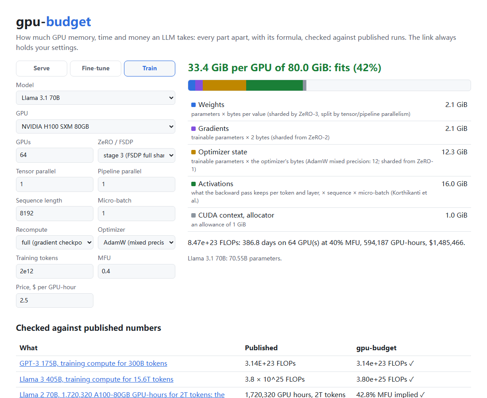

<div align="center">

# gpu-budget

**How much GPU memory, time and money training, fine-tuning or serving an LLM takes.** Every part is shown apart
(weights, gradients, optimizer state, activations, KV cache) with the formula it comes from, for ZeRO/FSDP, tensor,
pipeline and expert parallelism, LoRA/QLoRA, quantization and speculative decoding. One engine for the page and the
command line, checked against published training runs.

<a href="https://github.com/zch6a/gpu-budget/actions/workflows/ci.yml"></a>


<a href="LICENSE"></a>

**English** · [简体中文](README.zh-CN.md)

</div>

---

<p align="center"><a href="https://zch6a.github.io/gpu-budget/"></a></p>
<p align="center"><b><a href="https://zch6a.github.io/gpu-budget/">zch6a.github.io/gpu-budget</a></b>: the link always holds your settings, to share.</p>

```bash
npx github:zch6a/gpu-budget train llama-3.1-70b --gpus 64 --zero 3 --seq 8192 --recompute full --tokens 2e12 --price 2.5
```

```
Llama 3.1 70B on NVIDIA H100 SXM 80GB, train: per GPU
  weights                      2.1 GiB
  gradients                    2.1 GiB
  optimizer state             12.3 GiB
  activations                 16.0 GiB
  CUDA context, allocator      1.0 GiB
  total                       33.4 GiB  of 80.0 GiB: fits (42%)
  compute 8.47e+23 FLOPs (6 × 70.55B active params × tokens)
  time 386.8 days on 64 GPU(s) at 40% MFU of 989.5 TFLOPS: 594.19K GPU-hours, $1.49M
```

```bash
gpu-budget finetune llama-3.1-8b --method qlora --rank 16 --gpu rtx-4090     # 10.4 GiB of 24: fits
gpu-budget infer llama-3.1-70b --quant int4 --kv fp8 --ctx 32768 --batch 4    # weights, KV cache, buffer
gpu-budget infer ./config.json --gpu m5-max-128                               # any Hugging Face config.json
gpu-budget models | gpus
```

Exit status 0 when it fits, 1 when it does not (with what to try), 2 on an error; `--json` gives the numbers.

## Checked against published numbers

| What | Published | gpu-budget |
|---|---|---|
| [GPT-3 175B](https://arxiv.org/abs/2005.14165), training compute for 300B tokens | 3.14E+23 FLOPs | 3.14e+23 FLOPs |
| [Llama 3 405B](https://arxiv.org/abs/2407.21783), training compute for 15.6T tokens | 3.8 × 10^25 FLOPs | 3.80e+25 FLOPs |
| [Llama 2 70B](https://arxiv.org/abs/2307.09288), 1,720,320 A100 GPU-hours for 2T tokens | (Llama 3 reports 38–43% MFU) | 42.8% MFU implied |
| [ZeRO](https://arxiv.org/abs/1910.02054): model states of a 1.5B GPT-2, mixed-precision Adam | 16 bytes per parameter, at least 24 GB | 16 bytes, 24.9 GB |
| [vLLM](https://arxiv.org/abs/2309.06180): KV cache of one OPT-13B token in FP16 | 800 KB | 819,200 bytes |
| The 13 built-in models' parameter counts, from their architecture | Hugging Face's counts | equal, to the parameter |

Each row is a test ([src/records.js](src/records.js) holds the sources' own words). The architecture of every built-in
model is its `config.json`; its parameter count is recomputed from it and compared with the count Hugging Face
publishes for its weights.

## The formulas

- **Model states** ([ZeRO](https://arxiv.org/abs/1910.02054)): mixed precision with AdamW keeps 2 bytes of weights, 2 of
  gradients and 12 of optimizer state (FP32 master copy, momentum, variance) per parameter. ZeRO stage 1 shards the
  optimizer state over the data-parallel GPUs, stage 2 the gradients too, stage 3 (FSDP full shard) the weights too.
  Tensor and pipeline parallelism divide the model; expert parallelism divides the experts. 8-bit Adam, BF16 states
  and SGD are options.
- **Activations** (after [Korthikanti et al.](https://arxiv.org/abs/2205.05198)), per token and layer, the tensors the
  backward pass keeps, counted for today's layers (RMSNorm, gated MLP, grouped-query attention, FlashAttention); without
  FlashAttention the attention scores too, which grow with the sequence. Full recomputation keeps each layer's input.
  For Llama 3.1 8B this comes to the paper's 34·h bytes. Plus the FP32 logits for the loss.
- **LoRA/QLoRA**: the frozen weights in 16-bit, or 4-bit NF4 with double quantization (QLoRA; embeddings and output
  layer kept 16-bit); gradients and optimizer state only for the adapters, rank × (in + out) per adapted matrix.
- **Inference**: the weights at their format (INT4: 4 bits plus an FP16 scale per 128), the KV cache
  (2 × layers × KV heads × head size × bytes per token; DeepSeek-V3's latent attention its own size), a draft model for
  speculative decoding, a working buffer.
- **Compute**: 6 × active parameters × tokens, the convention the labs report totals in; time from the GPU's dense
  peak and an MFU you choose (40% by default); cost from your price per GPU-hour.

GPU figures are the makers' datasheets, dense tensor throughput (NVIDIA lists it with sparsity; dense is half),
checked on 2026-11-13; each links its source in [src/data.js](src/data.js).

## Limits

- These are estimates of what the tensors need. Frameworks add their own: allocator fragmentation, temporary buffers,
  communication buckets. The 1 GiB allowance (`--overhead`) covers the CUDA context, not all of that; leave headroom.
- Activations assume FlashAttention-style kernels and 16-bit training; frameworks that keep extra copies need more.
- Pipeline parallelism is counted as 1F1B with as many microbatches in flight as stages.
- Apple: the GPU may use about three quarters of the unified memory by default (an assumption; macOS can change it).
- No cloud prices built in yet: give yours with `--price`. AMD GPUs are not in the table yet (their pages could not be
  checked).

## Also in this toolkit

[exp-tables](https://github.com/zch6a/exp-tables) makes results tables with significance ·
[paper-proof](https://github.com/zch6a/paper-proof) checks a paper's references and numbers ·
[paper-page](https://github.com/zch6a/paper-page) makes a project page from an arXiv ID ·
[paper-impact](https://github.com/zch6a/paper-impact) shows which papers at AI venues mattered.

## License

MIT.
