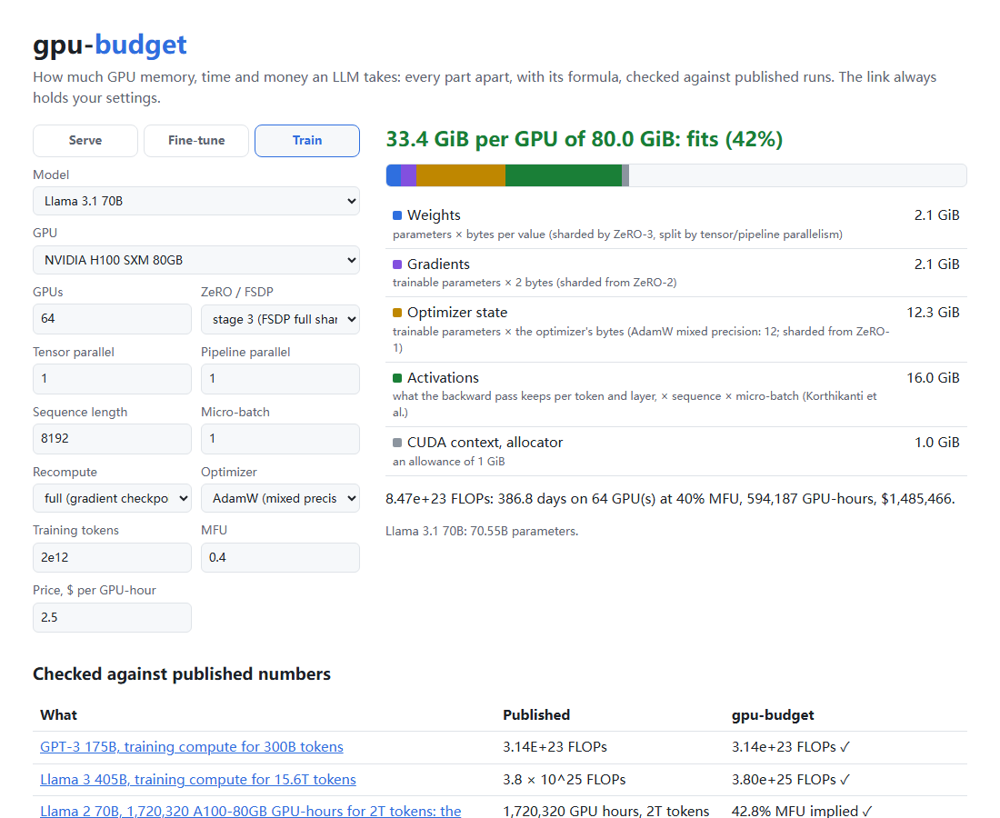

<div align="center">

# gpu-budget

**训练、微调或部署一个大模型要多少显存、多少时间、多少钱。** 每一部分（权重、梯度、优化器状态、激活、KV 缓存）分开列出并给出公式，
支持 ZeRO/FSDP、张量/流水线/专家并行、LoRA/QLoRA、量化与投机解码。网页和命令行用同一个计算引擎，并用公开的真实训练记录校验。

<a href="https://github.com/zch6a/gpu-budget/actions/workflows/ci.yml"></a>


<a href="LICENSE"></a>

[English](README.md) · **简体中文**

</div>

---

<p align="center"><a href="https://zch6a.github.io/gpu-budget/"></a></p>
<p align="center"><b><a href="https://zch6a.github.io/gpu-budget/">zch6a.github.io/gpu-budget</a></b>：网址里始终保存当前配置，可以直接分享。</p>

```bash
npx github:zch6a/gpu-budget train llama-3.1-70b --gpus 64 --zero 3 --seq 8192 --recompute full --tokens 2e12 --price 2.5
gpu-budget finetune llama-3.1-8b --method qlora --rank 16 --gpu rtx-4090     # 24 GB 中用 10.4 GiB：放得下
gpu-budget infer llama-3.1-70b --quant int4 --kv fp8 --ctx 32768 --batch 4
gpu-budget infer ./config.json --gpu m5-max-128                               # 任意 Hugging Face 的 config.json
```

放得下退出码为 0，放不下为 1（并提示可以怎么改），出错为 2；`--json` 输出数字。

## 用公开数字校验

| 内容 | 公开数字 | gpu-budget |
|---|---|---|
| [GPT-3 175B](https://arxiv.org/abs/2005.14165)，3000 亿 token 的训练计算量 | 3.14E+23 FLOPs | 3.14e+23 FLOPs |
| [Llama 3 405B](https://arxiv.org/abs/2407.21783)，15.6 万亿 token 的训练计算量 | 3.8 × 10^25 FLOPs | 3.80e+25 FLOPs |
| [Llama 2 70B](https://arxiv.org/abs/2307.09288)，2 万亿 token 用了 1,720,320 A100 GPU 小时 | （Llama 3 报告的 MFU 为 38–43%） | 推算 MFU 42.8% |
| [ZeRO](https://arxiv.org/abs/1910.02054)：15 亿参数 GPT-2 的混合精度 Adam 模型状态 | 每参数 16 字节，至少 24 GB | 16 字节，24.9 GB |
| [vLLM](https://arxiv.org/abs/2309.06180)：OPT-13B 一个 token 的 FP16 KV 缓存 | 800 KB | 819,200 字节 |
| 13 个内置模型由结构算出的参数量 | Hugging Face 公布的参数量 | 逐个参数完全相等 |

每一行都是一个测试（[src/records.js](src/records.js) 里有出处原文）。

## 公式

- **模型状态**（ZeRO）：混合精度 + AdamW 每个参数 2 字节权重、2 字节梯度、12 字节优化器状态（FP32 主副本、动量、方差）。ZeRO-1 把优化器状态分到各数据并行 GPU，ZeRO-2 再分梯度，ZeRO-3（FSDP 全分片）再分权重；张量与流水线并行切分模型，专家并行切分专家。
- **激活**（参照 Korthikanti 等人）：每个 token、每一层反向传播需要保留的张量，按现在的结构（RMSNorm、门控 MLP、GQA、FlashAttention）计算；不用 FlashAttention 时再加随序列增长的注意力分数。完全重计算只保留每层的输入。对 Llama 3.1 8B 正好等于论文的 34·h 字节。另加计算损失用的 FP32 logits。
- **LoRA/QLoRA**：冻结的权重为 16 位，或 4 位 NF4 加双重量化（QLoRA，嵌入与输出层保持 16 位）；梯度与优化器状态只算适配器，每个被适配的矩阵 rank × (输入 + 输出)。
- **推理**：权重按格式计（INT4 为 4 位加每 128 个一个 FP16 缩放），KV 缓存（每 token 2 × 层数 × KV 头数 × 头维度 × 字节；DeepSeek-V3 的潜在注意力按其自身大小），投机解码的草稿模型，工作缓冲区。
- **计算量**：6 × 激活参数 × token 数（各实验室报告总量的口径）；时间按 GPU 的稠密峰值和你设定的 MFU（默认 40%），费用按你给的每 GPU 小时价格。

GPU 数据来自厂商规格页，按稠密张量算力（NVIDIA 标的是稀疏值，稠密为其一半），2026-11-13 核对，每项在 [src/data.js](src/data.js) 里附出处。

## 局限

- 这是张量本身需要的显存估算；框架还会有分配器碎片、临时缓冲、通信桶等额外开销。默认的 1 GiB（`--overhead`）只覆盖 CUDA 上下文，请留出余量。
- 激活按 FlashAttention 类内核和 16 位训练估算；会多存副本的框架需要更多。流水线并行按 1F1B、在途微批数等于阶段数计算。
- Apple：默认 GPU 大约可用统一内存的四分之三（一个假设，macOS 可以调整）。
- 还没有内置云价格，请用 `--price` 给出；AMD GPU 暂未收录（其规格页无法核对）。

## 许可证

MIT。
